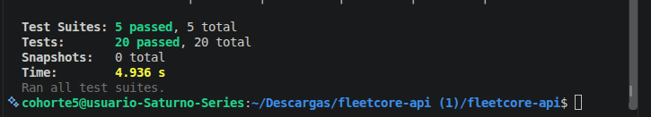

# FleetCore API

API REST para gestionar el mantenimiento de la flota de vehículos de **FleetCore**.
Stack: **NestJS · TypeScript · TypeORM · PostgreSQL · JWT · bcrypt · Swagger**.

> **Coder:** _Luis Mario Suarez Sevilla_  
> **Clan:** _NODEJS PM_

## Requisitos
- Node.js 20+
- PostgreSQL 14+ (o Docker)

## Instalación (local)

```bash
npm install
cp .env.example .env        # y ajusta los valores (ver abajo)
createdb fleetcore          # o: psql -U postgres -c "CREATE DATABASE fleetcore;"
npm run seed                # pobla la base de datos (idempotente)
npm run start:dev
```

Las tablas se crean solas al arrancar (`synchronize: true`, solo para esta prueba).

## Variables de entorno

| Variable | Descripción | Ejemplo |
|---|---|---|
| `PORT` | Puerto de la API | `3000` |
| `DB_HOST` / `DB_PORT` | Servidor de PostgreSQL | `localhost` / `5432` |
| `DB_USERNAME` / `DB_PASSWORD` | Credenciales de la BD | `postgres` / `postgres` |
| `DB_NAME` | Nombre de la BD | `fleetcore` |
| `JWT_SECRET` | Secreto para firmar los JWT (**cámbialo**) | `cambia-este-secreto` |
| `JWT_EXPIRES_IN` | Vigencia del token | `1h` |
| `API_KEYS` | API keys válidas para integraciones, separadas por coma | `demo-key-partner-1,demo-key-partner-2` |

Si falta alguna variable obligatoria, la app no arranca y dice cuál falta.

## Seeder

```bash
npm run seed
```

Es **idempotente**: cada registro se busca por su clave única antes de crearse, así que ejecutarlo dos veces no duplica datos.

Crea: 3 usuarios (1 ADMIN, 2 TECHNICIAN), 3 mecánicos (2 activos vinculados a los técnicos y 1 inactivo), 2 talleres (1 activo, 1 inactivo), 4 vehículos (2 AVAILABLE, 1 IN_MAINTENANCE con su mantenimiento IN_PROGRESS y 1 INACTIVE) y 1 mantenimiento COMPLETED para el historial.

## Credenciales de prueba

| Rol | Correo | Contraseña |
|---|---|---|
| ADMIN | `admin@fleetcore.com` | `Admin123*` |
| TECHNICIAN (Carlos Pérez) | `tech1@fleetcore.com` | `Tech123*` |
| TECHNICIAN (Laura Gómez) | `tech2@fleetcore.com` | `Tech123*` |

API keys de prueba (header `x-api-key`): `demo-key-partner-1`, `demo-key-partner-2`.

## Documentación Swagger

**http://localhost:3000/api/docs**

1. `POST /auth/login` con una de las credenciales.
2. Copia el `accessToken`, pulsa **Authorize** y pégalo (esquema Bearer).
3. Para `/integrations/...` usa el esquema `api-key` e ingresa una API key.

## Permisos por rol

| Acción | ADMIN | TECHNICIAN |
|---|:-:|:-:|
| CRUD de vehículos, mecánicos y talleres | ✅ | ❌ |
| Crear usuarios (cualquier rol) | ✅ | ❌ |
| Crear mantenimientos | ✅ | ❌ |
| Ver todos los mantenimientos / historiales | ✅ | solo los suyos |
| Cambiar estado de un mantenimiento | ✅ | solo los suyos |
| Consultar auditoría | ✅ | ❌ |

El registro público (`POST /auth/register`) **siempre crea TECHNICIAN**; no acepta `role`, para que nadie pueda auto-asignarse ADMIN.

## Endpoints principales

| Método | Ruta | Descripción |
|---|---|---|
| POST | `/auth/register`, `/auth/login` | Registro y login (públicos) |
| GET | `/auth/me` | Usuario autenticado |
| POST/GET | `/vehicles` | Crear / listar |
| GET | `/vehicles/:id`, `/vehicles/plate/:plate` | Consultar por id o placa |
| PATCH / DELETE | `/vehicles/:id` · `/vehicles/:id/activate` | Actualizar · inactivar (lógico) · reactivar |
| POST/GET/PATCH | `/mechanics`, `/mechanics/:id`, `/:id/activate`, `/:id/deactivate` | Gestión de mecánicos |
| POST/GET/PATCH | `/workshops`, `/workshops/active`, `/:id`, `/:id/activate`, `/:id/deactivate` | Gestión de talleres |
| POST | `/maintenances` | Crear (estado inicial SCHEDULED) |
| GET | `/maintenances`, `/active`, `/my`, `/vehicle/:id`, `/vehicle/:id/history`, `/mechanic/:id` | Consultas |
| PATCH | `/maintenances/:id/status` | Cambiar estado |
| GET | `/maintenances/audit/logs`, `/maintenances/:id/audit` | Auditoría |
| GET | `/integrations/vehicles/:plate/maintenances` | Integración externa con `x-api-key` |

## Decisiones de diseño (y ambigüedades del enunciado)

El enunciado tiene puntos ambiguos o contradictorios; estas son las decisiones tomadas:

- **Cruce de horarios.** El mantenimiento tiene `scheduledStart` y `scheduledEnd`. Dos rangos se cruzan si `startA < endB && endA > startB`, por lo que 7:30–9:00 y 9:00–10:30 **no** se cruzan. La regla "un solo mantenimiento activo" se aplica sobre ese cruce, tanto para el **mecánico** (en cualquier taller) como para el **vehículo**; así se pueden programar mantenimientos futuros sin solaparse. Además, un vehículo no puede tener dos mantenimientos `IN_PROGRESS` a la vez.
- **Transiciones de estado.** `SCHEDULED → IN_PROGRESS | CANCELLED` · `IN_PROGRESS → COMPLETED | CANCELLED` · `COMPLETED` y `CANCELLED` son finales. Una transición inválida responde **409** con un mensaje descriptivo.
- **Vehículo.** `IN_PROGRESS` ⇒ `IN_MAINTENANCE`; `COMPLETED` ⇒ `AVAILABLE` y el kilometraje del vehículo pasa al kilometraje final; cancelar un mantenimiento en proceso devuelve el vehículo a `AVAILABLE`.
- **Datos de cierre.** Para `COMPLETED` son obligatorios `workDone`, `finalCost`, `finishedAt` y `finalMileage` (400 si falta alguno). El kilometraje final no puede ser inferior al actual.
- **Técnico ↔ mecánico.** Un mecánico puede vincularse opcionalmente a un usuario TECHNICIAN (`userId`). El técnico solo ve y actualiza los mantenimientos de su mecánico.
- **Eliminación lógica.** `DELETE /vehicles/:id` marca el vehículo `INACTIVE` (no se borra) y se rechaza con 409 si tiene mantenimientos activos.
- **Auditoría.** Cada cambio de estado se guarda en `maintenance_status_logs` (de/a, quién y cuándo).
- **Historial.** Mantenimientos cerrados (`COMPLETED` y `CANCELLED`) de un vehículo, del más reciente al más antiguo.

## Arquitectura de seguridad y errores

- `JwtAuthGuard` (global): exige Bearer token salvo en rutas `@Public()`. Distingue token ausente, inválido y expirado (401).
- `RolesGuard` (global): valida `@Roles(...)` (403 si el rol no alcanza).
- `ApiKeyGuard`: valida `x-api-key` contra `API_KEYS` (variable de entorno), comparación en tiempo constante.
- Decoradores personalizados: `@Roles()`, `@CurrentUser()`, `@Public()` y `@ApiKeyAuth()`.
- `ResponseInterceptor`: respuestas uniformes `{ success, statusCode, data, timestamp }`.
- `AllExceptionsFilter`: errores uniformes `{ success:false, statusCode, message, path, timestamp }`; traduce errores de PostgreSQL (23505 unicidad → 409, etc.), de modo que ni validación, auth, 404 ni conflictos terminan en 500.
- Contraseñas con **bcrypt** (hash con salt). Las operaciones críticas de mantenimientos usan **transacciones** con bloqueo pesimista para evitar condiciones de carrera.

## Docker

```bash
cp .env.example .env
docker compose up --build -d
docker compose exec api npm run seed:prod     # poblar la BD dentro del contenedor
docker compose logs -f api
```

- API + PostgreSQL con **volumen** (`pgdata`) y **red interna** (`fleetcore-net`).
- `docker compose down` conserva los datos; `docker compose down -v` los borra.

## Pruebas unitarias

```bash
npm test
npm run test:cov
```

Cubren la máquina de estados, `RolesGuard`, `ApiKeyGuard`, el filtro de excepciones y el interceptor. La cobertura se mide sobre esa lógica clave (`common/` y la máquina de estados) y supera el 40 %.

## Dump SQL y evidencias

- Dump de estructura y datos: `database/fleetcore_dump.sql` (`psql -U postgres -d fleetcore -f database/fleetcore_dump.sql`).
- Colección de Postman: `postman/fleetcore.postman_collection.json`.
- Script de pruebas de los escenarios principales: `scripts/e2e.sh`.

### Resultados de pruebas

Ejecución de `npm test` y `npm run test:cov`:


Resumen final: 5 suites y 20 pruebas aprobadas.


